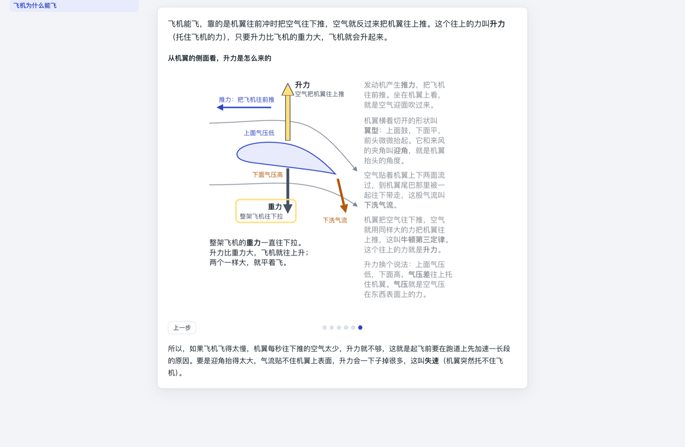

# Vibe Learning

想学什么，写一句话。AI 回答你的时候，会一边讲一边把背后的道理画成一张图：有哪几样东西、它们怎么连、背后是哪条规律。看懂了图，你就能自己往下推。

它在你自己的 Mac 上运行，用你自己的 Claude Code。




## 能做什么

- **每个回答一张 AI 自己画的图**。图上写真名字（术语），每个跟一句大白话。讲的是有先后的事，图会一页一页翻：每页出一个变化，讲它的那句话就画在旁边，像老师在白板上边讲边画。
- **哪段没看懂，选中它接着问**。问答挂在旁边的备注里，备注还能展开成一整页，里面再选中再问。
- **记着你一路是怎么问下来的**。左边的目录、顶上的地图，重点的页可以标颜色。
- **复述**：想看看自己是不是真懂了，用自己的话讲一遍。AI 把你讲的画出来，和正确的对比，改掉想错的地方。改好的图可以收进首页的「思维模型」。
- **都在你自己的电脑上**：学习记录存在本机，提问用的是你自己的 Claude Code 登录和额度。

## 安装

需要一台 Mac，装好并登录了 [Claude Code](https://claude.com/claude-code)。

**方法一（推荐）**：打开 Claude Code，把这句话发给它：

```
帮我安装 Vibe Learning：https://github.com/Tasihi89/vibe-learning
```

一两分钟就装好。装好后浏览器会自己打开首页，桌面上多一个「Vibe Learning」图标，Claude 会告诉你怎么用。

**方法二**：打开「终端」，粘贴这一行，按回车：

```
curl -fsSL https://raw.githubusercontent.com/Tasihi89/vibe-learning/main/install.sh | bash
```

### 给 Claude 看：帮用户安装时照这个做

1. 在终端运行 `curl -fsSL https://raw.githubusercontent.com/Tasihi89/vibe-learning/main/install.sh | bash`。它会确认装了 Claude Code，把程序放到 `~/.claude/skills/vibe-learning/`（同时是一个 skill，以后用户打 `/vibe-learning` 就能用），没有 18 版以上的 Node 就下载一份只给它用的（放在 `~/.vibe-learning/_node/`），再在「应用程序」里做图标、桌面放快捷方式、打开首页。不需要管理员密码。
2. 中途出错，照报错的话处理。多半是网络：上 GitHub 或 nodejs.org 要开代理的，请用户打开代理再运行一次。
3. 跑完，把最后「装好了」那一段原样转告用户。

## 怎么用

- **打开**：点桌面上的「Vibe Learning」（「应用程序」里也有，可以拖到程序坞），或者在 Claude Code 里打 `/vibe-learning`。
- **学**：在首页写一句想学的东西，按回车。有先后的事，图会分几页，点「下一步」往下翻。
- **追问**：哪一段没看懂，用鼠标选中它，点「问 Claude」。
- **复述**：鼠标移到回答上，点右上角的复述图标，用自己的话讲一遍。

## 要知道的

- **花的是你 Claude Code 的额度**。每个回答都用 Opus 认真想，一个回答一般要一两分钟，比平时聊天花得多。
- **学习记录**存在 `~/.vibe-learning/`，只在你的电脑上。
- **AI 能碰什么**：能上网查资料；只读得到每个学习项目自己的文件夹；只能往项目的 `files/` 里存东西；不能运行命令。想让它讲你电脑上的代码、软件，在 Claude Code 里说「让 Vibe Learning 能读我电脑上的文件」（会先跟你说清楚风险）。
- 目前只支持 Mac，页面和回答都是中文。

## 更新和卸载

- **更新**：在 Claude Code 里说「更新 Vibe Learning」，或者再运行一次上面那行安装命令。学习记录不动。
- **卸载**：在 Claude Code 里说「卸载 Vibe Learning」。

## 想用 Codex 或别的 AI

现在只支持 Claude Code。整个程序只有一处在调用 Claude：`serve.mjs` 里的 `startAgent()`。想换成 Codex 或别的命令行 AI，把这个仓库交给你的 AI，让它先读 `AGENTS.md` 的「换成别的 AI」，照着改这一个函数就行。

## 它是怎么运转的

```
浏览器里的页面  ⇄  serve.mjs（本机的小服务，127.0.0.1:4178）  ⇄  claude -p（你自己的 Claude Code）
                         │
                  ~/.vibe-learning/<项目>/：问答、资料
```

页面把问题和这一页的来龙去脉发给本机的小服务，小服务调用你电脑上的 Claude Code，回答边写边传回页面，页面边收边画。回答的格式和画图的规矩在 `answer-spec.md`，设计为什么是现在这样在 `docs/design.md`，改它之前先读 `AGENTS.md`。

## 协议

[MIT](LICENSE)。页面用到的开源库（marked、DOMPurify、KaTeX）和它们的协议见 [`vendor/`](vendor/README.md)。
