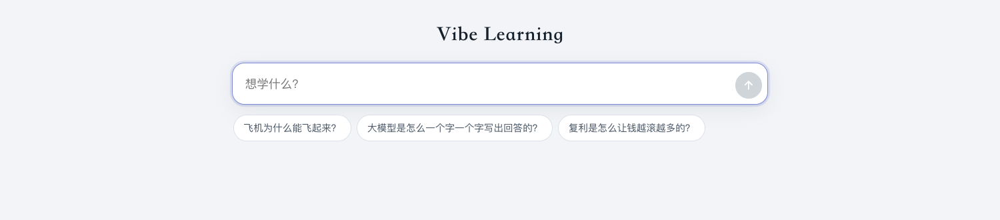
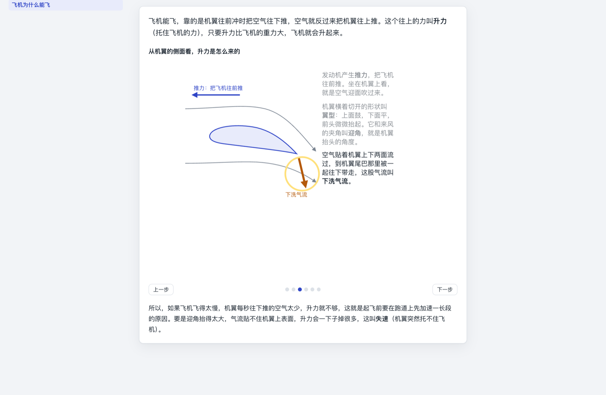

# Vibe Learning（Codex 版）

想学什么，写一句话。AI 回答你的时候，会一边讲一边把背后的道理画成一张图：有哪几样东西、它们怎么连、背后是哪条规律。看懂了图，你就能自己往下推。

它在你自己的 Mac 上运行，用你自己的 Codex。






## 能做什么

- **每个回答一张 AI 自己画的图**。图上写真名字（术语），每个跟一句大白话。讲的是有先后的事，图会一页一页翻：每页出一个变化，讲它的那句话就画在旁边，像老师在白板上边讲边画。
- **哪段没看懂，选中它接着问**。问答挂在旁边的备注里，备注还能展开成一整页，里面再选中再问。
- **记着你一路是怎么问下来的**。左边的目录、顶上的地图，重点的页可以标颜色。
- **复述**：想看看自己是不是真懂了，用自己的话讲一遍。AI 把你讲的画出来，和正确的对比，改掉想错的地方。改好的图可以收进首页的「思维模型」。
- **都在你自己的电脑上**：学习记录存在本机，提问用的是你自己的 Codex 登录和额度。

## 安装

需要一台 Mac，装好并登录了 [Codex 命令行](https://github.com/openai/codex)（`npm install -g @openai/codex` 或 `brew install --cask codex`，再运行 `codex login`）。

**方法一（推荐）**：打开 Codex，把这句话发给它（换成这个文件夹在你电脑上的位置）：

```
帮我安装 Vibe Learning：~/Desktop/vibe-learning-codex
```

一两分钟就装好。装好后浏览器会自己打开首页，桌面上多一个「Vibe Learning」图标，Codex 会告诉你怎么用。

**方法二**：打开「终端」，运行这个文件夹里的安装脚本：

```
bash ~/Desktop/vibe-learning-codex/install.sh
```

### 给 Codex 看：帮用户安装时照这个做

1. 用当前会话已有的权限运行这个文件夹里的 `install.sh`。脚本会检查 Codex 命令行，把程序装进 `~/.codex/skills/vibe-learning/`，在「应用程序」里做图标、桌面放快捷方式，再打开首页。如果找不到 Node 18 或更高版本，它会下载一份到 `~/.vibe-learning/_node/`。只有遇到宿主的访问限制且宿主支持授权时，才为受限的那一步申请权限。
2. 中途出错，照报错的话处理。多半是网络：上 nodejs.org 要开代理的，请用户打开代理再运行一次。
3. 跑完，把最后「装好了」那一段原样转告用户。

## 怎么用

- **打开**：点桌面上的「Vibe Learning」（「应用程序」里也有，可以拖到程序坞），或者在 Codex 里输入 `$vibe-learning`、说「打开 Vibe Learning」。
- **学**：在首页写一句想学的东西，按回车。有先后的事，图会分几页，点「下一步」往下翻。
- **追问**：哪一段没看懂，用鼠标选中它，点「问 Codex」。
- **复述**：鼠标移到回答上，点右上角的复述图标，用自己的话讲一遍。

## 要知道的

- **花的是你 Codex 的额度**。用的是你 Codex 设置里的默认模型，每个回答都用高思考力度认真想，一个回答一般要一两分钟，比平时聊天花得多。想换模型或思考力度，在 Codex 里说「Vibe Learning 换个模型」。
- **学习记录**存在 `~/.vibe-learning/`，只在你的电脑上。
- **AI 能访问哪些文件？** 默认提示词要求它只读当前项目和材料中列出的路径，沙箱没有强制限定这个读取范围。回答问题时，它可以把资料存进项目的 `files/`，也可以写入系统临时目录。开题时只能读取文件。它可以用网页搜索查资料，本地命令没有网络访问权限。想调整默认读取范围，在 Codex 里说「让 Vibe Learning 能读我电脑上的文件」。
- 目前只支持 Mac，页面和回答都是中文。
- 装过原来接 Claude Code 的那一版的话：这一版装好后会接管同一个「Vibe Learning」图标和同一份学习记录，两版不能同时用。

## 更新和卸载

- **更新**：拿到新版的文件夹后，在 Codex 里说「更新 Vibe Learning」，或者运行新版文件夹里的 `install.sh`。学习记录不动。
- **卸载**：在 Codex 里说「卸载 Vibe Learning」。

## 它是怎么运转的

```
浏览器里的页面  ⇄  serve.mjs（本机的小服务，127.0.0.1:4178）  ⇄  codex app-server（你自己的 Codex）
                         │
                  ~/.vibe-learning/<项目>/：问答、资料
```

页面把问题和这一页的来龙去脉发给本机的小服务，小服务起一个你电脑上的 Codex（`codex app-server`），回答边写边传回页面，页面边收边画。回答的格式和画图的规矩在 `answer-spec.md`，设计为什么是现在这样在 `docs/design.md`，改它之前先读 `AGENTS.md`。

## 协议

[MIT](LICENSE)。页面用到的开源库（marked、DOMPurify、KaTeX）和它们的协议见 [`vendor/`](vendor/README.md)。
